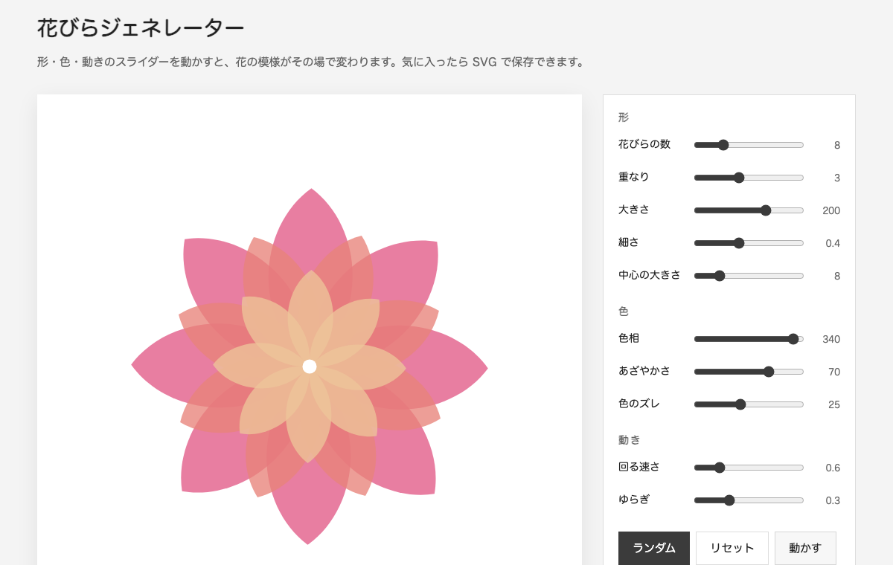

# 花びらジェネレーター（Petal Generator）

形・色・動きのスライダーを動かすと、花の模様が動く SVG アニメーションを作れる、ジェネレーティブアートです。
HTML・CSS・JavaScript だけで作っていて、ビルドも依存ライブラリもありません。



**デモ：** https://kiki-portfolio.kiki-works.workers.dev/generative-art
（ポートフォリオ内のページです。このリポジトリの `index.html` は、ブラウザで直接開いても動きます）

## できること

- 10 個のパラメータ（形・色・動き）をスライダーで調整
- ランダム生成、リセット、アニメーションの停止／再生
- 今の絵を SVG ファイルとして保存
- 設定をこのブラウザに保存（`localStorage`）
- OS の「視差効果を減らす」設定の人には、最初は止めた状態で表示

## 使い方

ビルドは不要です。`index.html` をブラウザで開くだけで動きます。

```bash
open index.html
```

## 仕組みと工夫したところ

### 型とスライダーを 1 か所で対応づける

パラメータの型を JSDoc の `@typedef`（`Params`）で定義し、スライダーの設計図 `PARAM_DEFS`（`key` / `min` / `max` / `step`）の配列から、画面のスライダーを自動で作っています。
パラメータを足すときは、型と `PARAM_DEFS` に 1 行ずつ足すだけで、UI・保存・ランダム生成まで対応します。TypeScript を使わなくても、エディタの補完で型が効きます。

| グループ | パラメータ |
| --- | --- |
| 形 | 花びらの数 / 重なり / 大きさ / 細さ / 中心の大きさ |
| 色 | 色相（0〜360） / あざやかさ / 色のズレ（重なりごと） |
| 動き | 回る速さ / ゆらぎ |

### 描画は「純粋関数」

`render(params, time)` は、同じパラメータと時刻なら、いつも同じ SVG 文字列を返します。
画面の表示（`requestAnimationFrame` で時刻を進める）と、SVG の保存（今の時刻の一コマ）で、同じ関数を使っています。

- 花びら 1 枚を、中心から伸びるしずく形のベジェ曲線で描き、`rotate` で円状に並べる
- 層ごとに回る向きを逆にし、内側ほど小さく・明るく、色相も少しずつずらして奥行きを出す
- `sin` で花全体を呼吸のように伸び縮みさせる（ゆらぎ）

### 壊れにくくする工夫

- 保存された設定は、読み込むときに範囲におさめて（`clamp`）、壊れたデータや古いデータでも動くようにした
- `localStorage` が使えない環境でも、`try/catch` で止まらないようにした

## ファイル

| ファイル | 内容 |
| --- | --- |
| `index.html` | ページ本体（CSS と JavaScript を中に入れた 1 ファイル） |
| `docs/screenshot.png` | README 用の画面 |

## ライセンス

[MIT](LICENSE)
